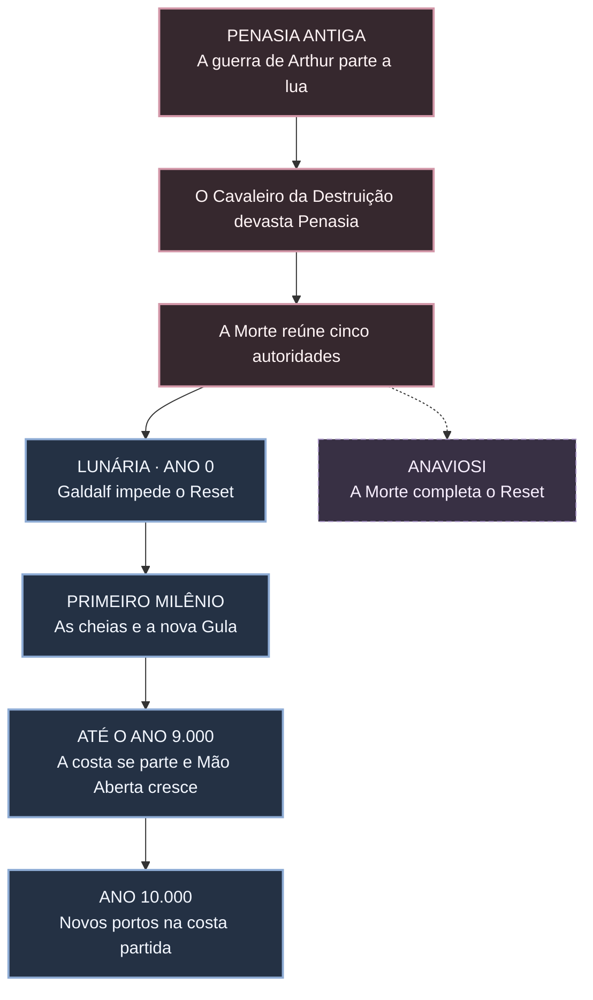
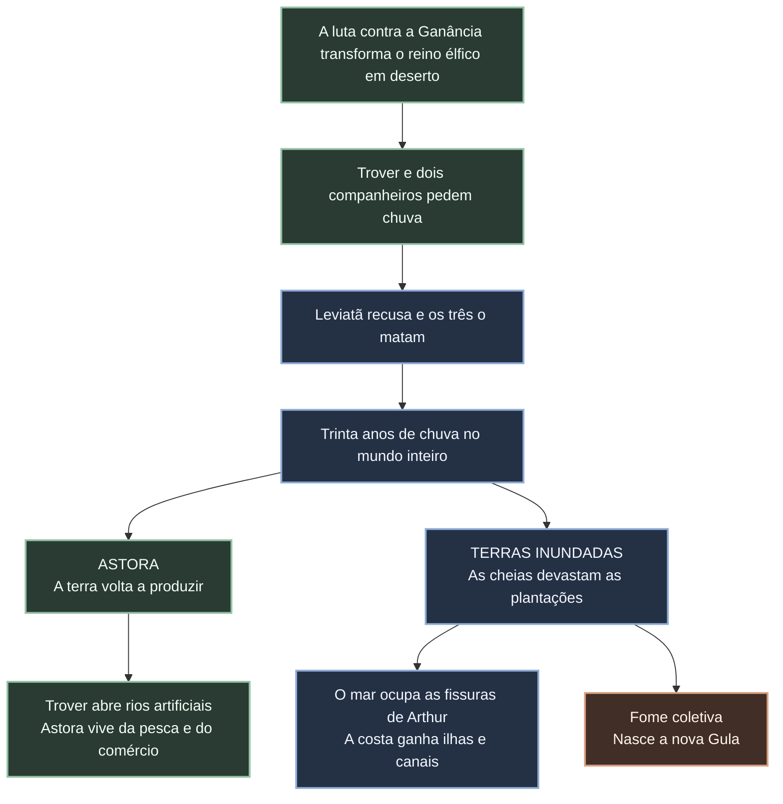

# Linha do tempo de Lunária

[[Índice da lore|Índice]] · [[Panteão de Penasia e Lunária|Panteão antigo e atual]] · [[O surgimento das Sete Bruxas|Origem das Bruxas]]

A [página De Penasia a Lunária](http://localhost:4321/a-divisao-das-realidades#cronologia) apresenta a árvore dos dois futuros e os dez mil anos divididos por eras. O [mapa do Ano 10.000](http://localhost:4321/a-divisao-das-realidades#mapa) mostra a costa partida e as rotas de travessia.

> [!summary] Os dois calendários
> **Penasia antiga** conta os anos a partir do nascimento de Putária. **Lunária** recomeça a contagem com a morte do cavaleiro da Morte. O presente fica por volta do **Ano 10.000 de Lunária**.

## Antes de Lunária

As datas abaixo seguem o calendário da antiga Penasia. O [livro completo em Markdown](../../../penasia%20em%20md.txt) reúne as eras, as origens do panteão e as primeiras histórias da Fundação de DROP.

| Era | O que ficou para Lunária |
|---|---|
| **Criação · cerca de −1.000 a 60** | Da luz surgiu Bonzão. Da sua sombra, Malzão. Os espíritos dos elementos deram origem aos primeiros povos. A Luxúria trouxe o desejo, a Gula trouxe a fome e o cultivo, e a Ganância deu impulso aos primeiros reinos. Veja a [[O surgimento das Sete Bruxas#As primeiras Bruxas da antiga Penasia\|ordem de nascimento das sete]]. Excalibur surgiu no **ano 50**, sob Arthur. |
| **Destruição · 60–100** | Arthur enfrentou a Bruxa do Orgulho por onze anos. A lua se partiu e o continente rachou. Arthur caiu em **71**. As guerras pelas terras de Excalibur duraram até **100**. |
| **Paz · 100–1017** | Um rei de Excalibur entregou gente à Gula em troca de ajuda para formar um exército. No Continente Sombrio, a Bruxa criou os Titânicos. Por volta de **1000**, ela massacrou quase todos. Seus laboratórios ficaram do outro lado do oceano. |
| **Bruxas Mortas · a partir de 1017** | Galdalf, DROP e seus aliados mataram a Gula. Nesse período, a antiga Ganância caiu e seu reino élfico foi arrasado. Trover ficou com os sobreviventes. A Morte recolheu as autoridades da Gula, da Ganância e da Luxúria, depois matou a Inveja. Quando os Espadas devastaram Punho Aberto, Galdalf se selou na biblioteca. Voltou para matar a Preguiça, que tinha sido como uma mãe para ele. A Morte tomou sua quinta autoridade. |
| **Antes do Ano 0 de Lunária** | O Cavaleiro da Destruição matou mais da metade da população de Penasia para preparar o Reset da Morte. Os Elfos das Cinzas foram exterminados na queda do Monte Cinza. |

## Ano 0 de Lunária · O Reset impedido

Galdalf mata o cavaleiro da Morte antes que ele reúna Ira e Orgulho. Toma as cinco autoridades que o cavaleiro carregava e as deixa livres. Os Pecados continuam agindo no mundo, mesmo quando suas autoridades passam séculos sem ganhar corpo.

- **Lunária** segue a história da Penasia que sobreviveu.
- **Anaviosi** nasce no outro futuro, em que a Morte completa o Reset. Genbu leva para lá a tecnologia da antiga Penasia.

## Começo de Lunária · Trinta anos de chuva

A batalha contra a Ganância deixou o antigo reino élfico no deserto. Os sobreviventes ficaram por apego à terra e porque não tinham para onde ir. No começo de Lunária, **Trover e dois companheiros** pediram ao Leviatã chuva para recuperar o solo. O deus recusou. Os três o mataram. A chuva que se seguiu atingiu o mundo inteiro e durou **trinta anos**. O ano exato em que começou segue em aberto.

| Momento | O que aconteceu |
|---|---|
| **A terra volta a dar sustento** | A chuva recuperou parte do antigo reino. Os sobreviventes formaram uma comunidade de recursos divididos igualmente. Deram a ela o nome de **Astora**, companheiro de Trover que participou da queda da Ganância e partiu em uma aventura. |
| **A chuva continua** | Trover abriu rios artificiais para aumentar a quantidade de peixes. A pesca alimentou Astora, e a venda de peixe virou seu comércio. Em outras regiões, as inundações devastaram plantações e cortaram rotas. A água entrou pelas antigas fissuras de Arthur. |
| **A fome toma forma** | Muita gente morreu de fome. A fome coletiva fortaleceu a autoridade da Gula até ela ganhar corpo. Foi a [[O surgimento das Sete Bruxas#A primeira fome da nova Gula\|primeira Bruxa a tomar forma por si em Lunária]]. |

## Por volta do Ano 30 · O Orgulho se parte

Galdalf e a Ira derrotam a antiga Bruxa do Orgulho, que divide sua autoridade em três. Galdalf recebe um fragmento. Pouco depois, a Ira o desafia e morre no duelo, segundo o relato conhecido. O Ano 30 segue como data proposta.

## Anos 700–3.000 · As rotas se partem

| Quando | O que acontece | O que muda na vida das pessoas |
|---|---|---|
| **Por volta de 700 · A biblioteca fecha** | Hécate tira a própria vida ao perceber que Galdalf a superou. Quando ele se sela por dentro, grande parte da magia o acompanha. | As obras arcanas enfraquecem. Os livros dos vivos e dos mortos ficam inacessíveis, e a Centelha dos Titãs perde força. |
| **Por volta de 1.080 · A rota sob a serra** | Os anões abrem seus túneis para quem precisa atravessar regiões isoladas pelas cheias. | Aparece uma rota de comércio e refúgio pelas montanhas. O Punho Rubro se fixa nas passagens acima da serra. |
| **Entre 1.000 e 3.000 · A costa vira arquipélago** | As águas avançam pelas fissuras da guerra de Arthur, e parte da costa vira arquipélago. Uma pessoa guerreira defende uma ilha disputada e se funde a um fragmento do Orgulho. Nasce a **Bruxa da Ilha**. | Estradas acabam na água. Quem segura a ponte ou mantém uma balsa decide por onde chegam comida e viajantes. |

## Anos 3.000–10.000 · As novas cidades e a volta ao Continente Sombrio

| Quando | O que acontece | O que muda na vida das pessoas |
|---|---|---|
| **Entre 3.000 e 6.000 · A guerra dos reis** | Uma mulher põe reis de margens opostas em guerra e se funde à Luxúria. A pessoa que surge carrega a história da mulher e a de Putária. | Putópia passa a receber emissários de reinos que ainda se recusam a negociar publicamente entre si. |
| **Por volta de 5.850 · O inverno do pão** | Uma cheia arruína a colheita de uma margem. A Fundação de DROP organiza a distribuição de grão por casa em Mão Aberta. | As famílias guardam na soleira a marca da primeira remessa para que a próxima carga ache o caminho. |
| **Por volta de 7.200 · O primeiro Jubileu** | A Fundação compra dívidas de travessia dos credores de Mão Aberta e rasga os recibos diante das famílias. | O perdão libera barqueiros e moleiros. Em Putópia, credores compram contratos que antes julgavam sem valor, esperando vendê-los à Fundação. |
| **Antes do Ano 10.000 · O fim de Putópia e Preguicite** | As duas cidades deixam de existir. A data e as causas ainda estão em proposta. | O mapa do presente situa as duas como ruínas. As travessias passam por portos mais recentes. |
| **Por volta de 10.000 · A volta ao Continente Sombrio** | Navegadores encontram os antigos desembarques, os laboratórios da Gula e as ruínas dos Titânicos. | As expedições que seguem para o interior voltam com relatos diferentes sobre o que encontraram. |

> [!warning]- Só o Mestre · O Continente Sombrio
> Arkhan reúne deuses menores contra a antiga Bruxa do Orgulho antes que Galdalf e a Ira a derrotem. Depois da divisão da autoridade, Midra se funde com um fragmento. Arkhan usa essa fusão para convencer Shar a entrar em seu corpo. Os dois se tornam uma nova pessoa, o Vazio de Lunária. A data da fusão segue em aberto. [[Mestre — Os dez mil anos depois de Galdalf#Arkhan assume o Vazio|Leia a passagem completa]].

## Para continuar

O [[Panteão de Penasia e Lunária]] reúne as mortes das divindades e as entidades que atravessaram os milênios.

Leia [[Penasia — A história do mundo]] para acompanhar a criação e a história das Bruxas em prosa. As notas de bastidores estão em [[Mestre — Os dez mil anos depois de Galdalf]].

Voltar ao [[Índice da lore]].
